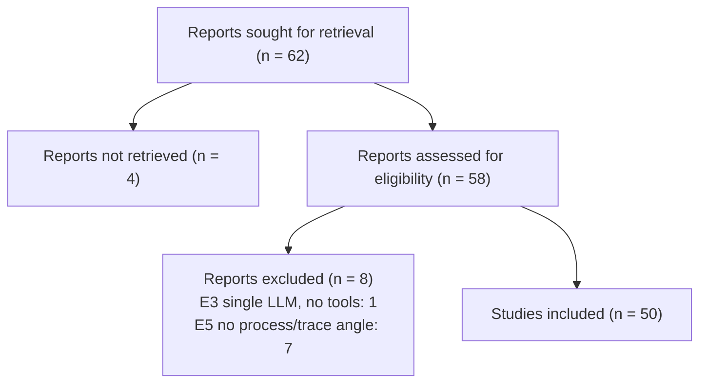

# PRISMA 2020 counts – full-text stage (single reviewer, "go light")

| Step | Count |
|---|---|
| Reports sought for retrieval | 62 |
| Reports not retrieved | 4 (R00012 MSR 2026 Mining Challenge; R00026 Information Systems, Elsevier; R00041 Future Internet, MDPI; R00061 BPM 2025 Workshops, Springer – no open PDF reachable from this environment) |
| Reports assessed for eligibility | 58 |
| Reports excluded | 8 – E3 single LLM without tools/environment: 1 (R00005, kept as background); E5 no process/trace angle: 7 (R00025, R00028, R00036, R00044, R00045, R00046, R00052) |
| Studies included (before citation check) | 50 |

Reviewer: one AI reviewer (Claude Opus 5.5, `claude-opus-5-5`, main Claude Code session) reading the text extracted from each PDF with pypdf. No second reviewer, no adjudication, so no full-text agreement statistics. Six exclusions and several inclusions are flagged "borderline" or "low relevance" in `FT_single_reviewer_log.csv` for Frank's check. **Counts are provisional until Frank verifies the included set.**
