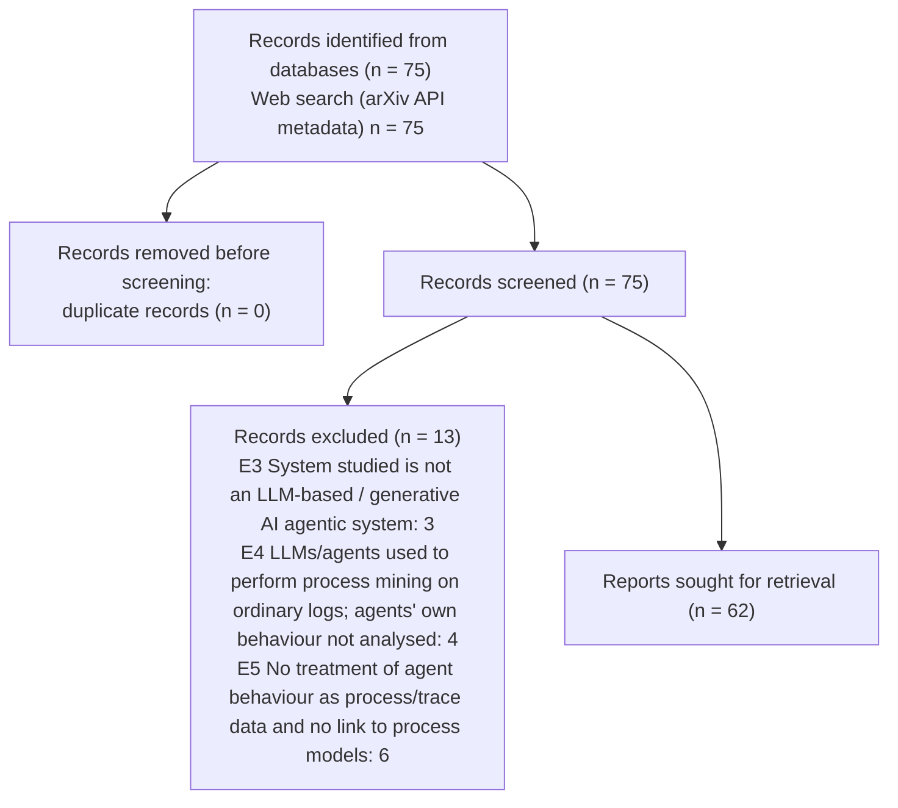

# PRISMA 2020 counts - title/abstract stage



```json
{
 "stage": "ta",
 "tool": "sr-screener 1.0.0",
 "complete": true,
 "pending_records": 0,
 "state_problems": [],
 "identified_by_database": {
  "Web search (arXiv API metadata)": 75
 },
 "identified_total": 75,
 "duplicates_removed": 0,
 "records_screened": 75,
 "records_to_screen": 75,
 "records_excluded": 13,
 "excluded_by_code": {
  "E3": 3,
  "E4": 4,
  "E5": 6
 },
 "reports_sought_for_retrieval": 62,
 "advanced_include": 43,
 "advanced_unclear": 19,
 "advanced_outside_allowed_languages": 0,
 "agreement": {
  "n": 75,
  "both_advance": 57,
  "both_exclude": 14,
  "a_only_advance": 0,
  "b_only_advance": 4,
  "observed_agreement": 0.9467,
  "kappa": 0.842,
  "pabak": 0.893,
  "conflicts": 4,
  "resolved_by": {
   "A+B": 69,
   "Frank": 2,
   "ADJ": 3,
   "QC": 1
  }
 },
 "decided_by": {
  "A+B": 69,
  "Frank": 2,
  "ADJ": 3,
  "QC": 1
 }
}
```
